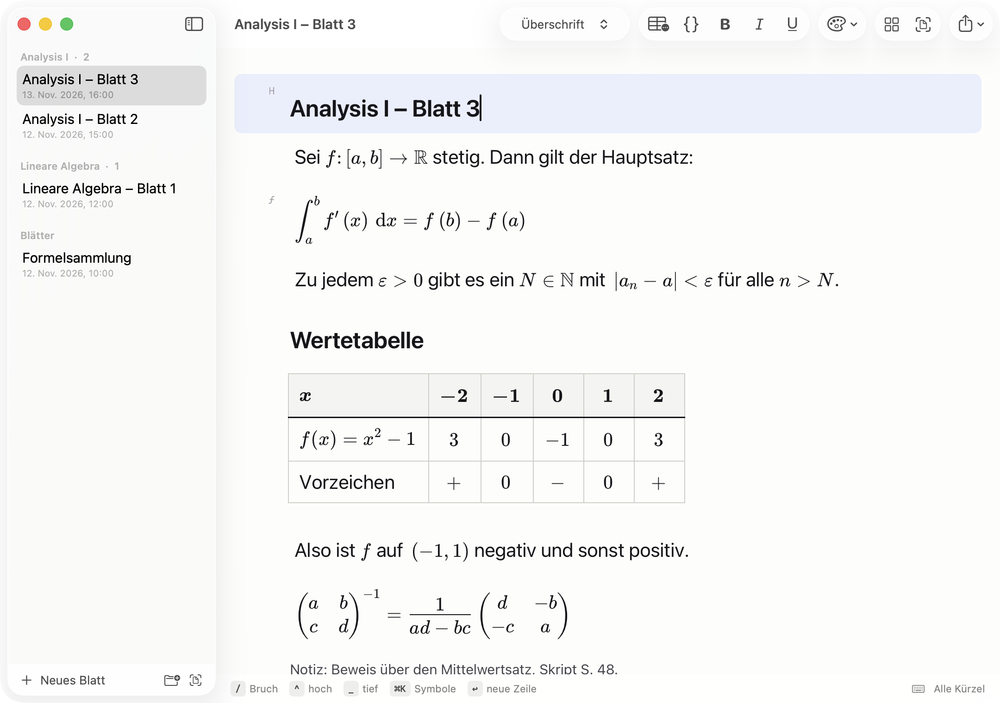
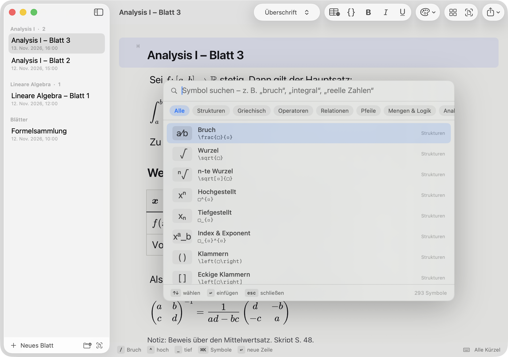
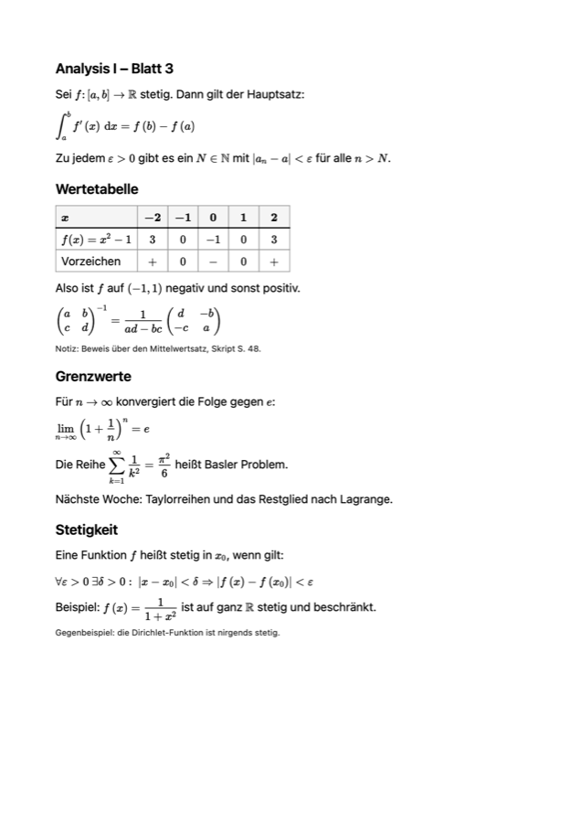

# MathPad

Ein Mac-Notizblock für Mathematik. Du tippst, es steht sofort gesetzt da.







## Die Idee

Formeln schreibt man am schnellsten mit der Tastatur – aber Mathematik ist
zweidimensional. MathPad löst das mit einem **Struktur-Editor**: du tippst `/`
und es entsteht ein echter Bruch, `^` geht nach oben, `_` nach unten, die
Pfeiltasten laufen durch die Formel statt durch Text. Unter der Oberfläche liegt
LaTeX, deshalb ist **jeder** Ausdruck darstellbar – Matrizen, Fälle, Integrale,
Tensoren.

Drei Ebenen, je nachdem wie genau du es wissen willst:

1. **Einfach tippen.** `1/2`, `x^2`, `alpha`, `sqrt`, `int`, `lim` – rund 270
   Abkürzungen verwandeln sich beim Schreiben.
2. **⌘K – Symbolpalette.** 293 Symbole und Vorlagen, durchsuchbar nach deutschem
   Namen: „bruch", „reelle Zahlen", „fallunterscheidung", „Intervall", „Eigenraum".
   Unscharfe Suche: `grsgl` findet „Größer gleich". Du musst kein LaTeX können.
3. **⌥⌘L – LaTeX-Quelltext.** Für die Zeile, bei der du es genau steuern willst.

## Zeilenarten

Ein Blatt ist eine Liste von Zeilen, `↩` macht die nächste. Fünf Arten, umschaltbar
mit `⌥⌘1` bis `⌥⌘5`:

| Art | Wofür |
|---|---|
| **Formel** | Abgesetzte Gleichung, allein in der Zeile |
| **Text + Formel** | Beides gemischt: „Sei $f\colon\mathbb{R}\to\mathbb{R}$ stetig mit $f(0)=1$" |
| **Text** | Fließtext in Formelgröße — der Normalfall für Aufgabentexte |
| **Notiz** | Kleinere Anmerkung am Rand des Gedankengangs |
| **Überschrift** | Aufgabennummer, Abschnittstitel |

Dazu kommt die **Tabelle** als eigene Zeile – sie wird mit `⇧⌘T` eingefügt statt
umgestellt, siehe [Tabellen](#tabellen).

Alle Größen hängen an einer Zahl: Text, Mischzeile und Formel sind gleich groß,
die Überschrift 20 % größer, die Notiz knapp 30 % kleiner. `⌘+` und `⌘−`
verschieben alles gemeinsam.

Reiner Text bricht um, eine Formel nicht — Text ist damit auch die bessere Wahl
für lange Aufgabenstellungen ohne Formelanteil.

„Text + Formel" ist der Normalfall auf Arbeitsblättern. In so einer Zeile
schreibst du einfach Text, und nur was eindeutig Formel ist, wird Formel:

| Du tippst | Wird |
|---|---|
| ein einzelner Buchstabe (`x`, `f`, `A`), sobald das Wort fertig ist | Formel |
| `=` `<` `>` `^` `_` `\` `\|` | Beginnen eine Formel und nehmen den Buchstaben davor mit |
| `+` `-` `/` `*` neben einer Formel | Formel – sonst bleibt „Aufgaben-Blatt" ein Wort |
| `f(`, `sin(`, `n!` | Formel |
| `alpha`, `RR`, `NN`, `infty` | α, ℝ, ℕ, ∞ |
| Leertaste in einer Formel | Zurück zu Text; im Index oder Nenner erst hinaus |
| `$` | Von Hand umschalten, dazwischen sind Leerzeichen Formel-Abstand |

„Sei x > 0 und f(x) = x^2 gilt" ergibt also `\text{Sei }x>0\text{ und }f(x)=x^2\text{ gilt}`.
MathLives Kürzel greifen nie mitten in einem Wort („Beispiel", „Kosinus", „gilt"
bleiben, was sie sind), und Abkürzungen wie „z. B." oder „d. h." bleiben Text.
Nachsehen kannst du jederzeit mit `⌥⌘L` – der Text steckt in `\text{…}`.

### Einfügen

`⌘V` versteht, was man typischerweise kopiert, und legt es als passende Zeilen an:
Sätze mit Formeln als „Text + Formel", abgesetzte Gleichungen als „Formel",
Überschriften als Überschrift, HTML-Tabellen als Tabelle, Fettdruck bleibt fett.

- **Aus dem Browser** (ChatGPT, Claude, Wikipedia, MathJax-Seiten): aus der
  mitkopierten MathML. Brüche, Wurzeln, Matrizen, Fallunterscheidungen, Summen,
  Akzente und ℝ kommen exakt an.
- **Markdown** mit `$…$`, `$$…$$`, `\(…\)`, `\[…\]` – etwa vom Kopieren-Knopf in ChatGPT.
- **Reiner Text, wie Browser gerenderte Formeln ausgeben** („𝑔 ∘ 𝑓 g∘f" mit jedem
  Zeichen doppelt): wird repariert, inklusive Indizes und Exponenten. Brüche und
  Wurzeln lassen sich aus dieser Textform nicht zurückgewinnen – dann lieber aus
  dem Browser direkt kopieren.
- **Text ohne Markierung** in eine Text+Formel-Zeile: bekommt dieselben Regeln wie
  beim Tippen.

In eine leere Zeile eingefügt, ersetzen die Zeilen sie; sonst landet der erste
Absatz an der Cursorposition und der Rest darunter. Ein `⌘Z` nimmt das ganze
Einfügen zurück.

Wenn eine Stelle doch danebenliegt – `dx` als Wort, ein Wort als Variable –
markierst du die Stelle und wählst per Rechtsklick **„Auswahl ist Text"** oder
**„Auswahl ist Formel"**. Ein Häkchen zeigt, wie sie gerade gesetzt ist. Im selben
Menü liegen Fett/Kursiv/Unterstrichen und die Symbolpalette.

## Formatieren

`⌘B` fett, `⌘I` kursiv, `⌘U` unterstrichen — in Formeln genauso wie in Notizen.
Schriftfarbe und Textmarker sitzen im Menü **Format** und in der Werkzeugleiste.
Ohne Auswahl gilt alles für die ganze Zeile.

In einer Formel greift „fett" auf beide Anteile: die Mathematik wird `\bm{…}`,
der Text darin `\textbf{…}`. Unterstrichen wird mit `\underline{…}` umschlossen,
Farbe mit `\textcolor{…}`, der Marker mit `\colorbox{…}`.

Ein Textmarker setzt die Schrift zusätzlich auf einen dunklen Ton. Markerfarben
sind hell; ohne das würde markierter Text im Dunkelmodus hell auf hell stehen.
Aus demselben Grund sind die Schriftfarben so gewählt, dass sie auf beiden
Hintergründen lesbar bleiben — die Farbe steht im Dokument, das Thema kann sich
danach noch ändern.

Notizzeilen speichern dafür ein schmales HTML (`<b>`, `<i>`, `<u>`, `<span>` mit
Farbe). Beim Export wird daraus `**fett**` in Markdown beziehungsweise
`\textbf{…}` in LaTeX.

### Lange Zeilen

MathLive setzt Formeln mit festen Positionen und kann nicht umbrechen — eine
lange Zeile scrollt daher seitwärts, statt in die nächste Zeile zu laufen. Wo das
passiert, wird der rechte Rand ausgeblendet: das Zeichen dafür, dass es
weitergeht.

### Hochstellen auf deutscher Tastatur

`^` ist auf deutschen (und Schweizer, französischen …) Layouts eine Totaste. Der
Browser meldet dabei nur „Dead" und hält den Zirkumflex für das nächste Zeichen
zurück, sodass MathLive ihn nie zu sehen bekommt. MathPad fängt die Taste ab und
macht daraus zuverlässig eine Hochstellung. Falls es an einem Layout doch klemmt:
`⌃6` stellt hoch, `⌃-` tief.

### Zeilenart wechseln

Eine Formelzeile speichert LaTeX, eine Textzeile HTML — beim Umstellen wird der
Inhalt deshalb mit umgerechnet, nicht bloß durchgereicht:

- **Formel → Text** zeigt die Formel in Klartext: `\frac{a}{b}` wird `(a)/(b)`.
- **Text → Formel** liest den Klartext wieder als Mathematik, `(a)/(b)` wird
  wieder zum Bruch. Enthält der Text einen Backslash, gilt er als LaTeX und wird
  wörtlich übernommen.
- **Text → Text + Formel** liest den Satz mit denselben Regeln wie beim Tippen:
  „Sei x > 0" wird `\text{Sei }x>0`. Was danebenliegt, korrigierst du per Rechtsklick.

Wird zwischendurch nichts bearbeitet, kommt beim Zurückstellen das Original
zurück — auch eine Matrix, für die es keine gute Klartextform gibt.

### Widerrufen

`⌘Z` nimmt zurück, `⇧⌘Z` stellt wieder her — und zwar für das ganze Blatt, nicht
nur für das Feld unter dem Cursor: Tippen, Zeilenart, Löschen, Verschieben,
Formatierung und ein kompletter Import (als ein Schritt). Tippen wird zu Bündeln
zusammengefasst, damit nicht jeder Buchstabe ein eigener Schritt ist. Der Verlauf
gehört zum Blatt und endet beim Blattwechsel.

## Tabellen

`⇧⌘T` fügt eine 3 × 3-Tabelle ein; über das Tabellen-Symbol in der Symbolleiste
wählst du die Größe auf einem Raster (bis 8 × 8, danach wächst sie beim Tippen).
Steht der Cursor in einer leeren Zeile, wird diese Zeile zur Tabelle, sonst kommt
die Tabelle darunter.

Jede Zelle ist eine kleine „Text + Formel"-Zeile: `Nullstelle` wird Text,
`x^2-1` wird Formel, Brüche, Wurzeln und Matrizen gehen genauso.

| | |
|---|---|
| `⇥` / `⇧⇥` | Nächste / vorige Zelle – in der letzten Zelle entsteht eine neue Zeile |
| `↩` | Zelle darunter – in der letzten Zeile entsteht eine neue Zeile |
| Pfeiltasten | Am Rand einer Zelle in die Nachbarzelle, am Tabellenrand in die nächste Zeile des Blatts |
| `⌘↩` | Unter der Tabelle mit Text weiterschreiben |
| **+** rechts / unten | Spalte / Zeile anfügen |
| Rand einer Zelle ziehen | Spaltenbreite; Doppelklick stellt auf automatisch zurück |
| Rechtsklick, Menü **Tabelle** oder Symbolleiste | Zeilen und Spalten einfügen oder löschen, Kopfzeile, Ausrichtung der Spalte, Linien (Gitter / nur waagerecht / ohne) |

Spalten sind so breit wie ihr Inhalt; eine gezogene Breite ist eine Mindestbreite
und wächst mit `⌘+`/`⌘−` mit. Alles davon lässt sich mit `⌘Z` widerrufen. Eine
Tabelle verschwindet mit `⌫` nur, wenn keine Zelle mehr etwas enthält.

Beim Export wird sie zu einer `tabular` (LaTeX) bzw. einer Pipe-Tabelle
(Markdown), mit Zellen als `$…$`. Beim Einlesen von Arbeitsblättern erkennt die
KI Wertetabellen und legt sie direkt als Tabelle an.

## Als PDF sichern

`⇧⌘P` setzt das Blatt auf **DIN-A4-Seiten** (2 cm Rand, Formeln in 12 pt, Seitenzahl
unten), immer hell, unabhängig vom Darkmode. Es wird nicht der Bildschirm
abfotografiert: Text+Formel-Zeilen werden neu als Fließtext gesetzt und brechen
zwischen Wörtern um wie jeder Satz, nichts wird am Rand abgeschnitten. Nur eine
einzelne Formel oder Tabelle, die für sich breiter ist als die Seite, wird passend
verkleinert.

Ist eine Seite voll, geht es auf der nächsten weiter — bevorzugt zwischen zwei
Zeilen des Blatts; ein Absatz oder eine Tabelle, die länger als eine Seite ist,
wird zwischen Textzeilen bzw. Tabellenzeilen getrennt. Text bleibt im PDF Text
(durchsuchbar, kopierbar).

## Arbeitsblatt einlesen

`⇧⌘I`, oder die Datei aufs Blatt ziehen, oder sie mit MathPad öffnen. Eine Seite
pro Import – PDF (erste Seite) oder Screenshot.

Danach fragt MathPad, ob daraus ein **neues Blatt** werden soll oder ob die
erkannten Zeilen **an der Cursor-Position** eingefügt werden. Grafische
Abbildungen werden übersprungen; Text und Formeln landen als passende Zeilenart.

### Welche Erkennung? (`⌘,`)

| | Formeln | Kosten | Einrichtung |
|---|---|---|---|
| **Claude Code (lokal)** | ✔ echtes LaTeX | keine über dein Abo hinaus | einmal `claude auth login` im Terminal |
| **KI-Dienst (API)** | ✔ echtes LaTeX | pro Anfrage | API-Schlüssel eintragen |
| **Apple Vision** | ✘ nur Text | keine | keine, läuft offline |

**Claude Code** ist der Standard, wenn die CLI auf dem Mac gefunden wird: MathPad
ruft sie auf, die Erkennung läuft über deine bestehende Anmeldung und zählt auf
dein normales Nutzungskontingent – kein separater API-Schlüssel, keine
Zusatzabrechnung. Dein Abo und die Anthropic-API sind getrennte Töpfe; über die
CLI nutzt du das Abo, das du schon hast.

**KI-Dienst** spricht drei Protokolle und deckt damit praktisch alles ab:

- *Anthropic* – `https://api.anthropic.com/v1`
- *OpenAI-kompatibel* – OpenAI, OpenRouter, Groq, Together, Mistral, und lokale
  Server: Ollama (`http://localhost:11434/v1`) oder LM Studio
  (`http://localhost:1234/v1`), dort bleibt das Schlüsselfeld leer
- *Google* – Gemini

Adresse, Modellname und Schlüssel sind frei eintragbar, ein „Verbindung testen"
prüft alles drei, bevor du eine Seite verschwendest. Schlüssel liegen im
macOS-Schlüsselbund, nicht in den Einstellungen der App.

**Apple Vision** braucht nichts und läuft offline, liefert aber reinen Text:
`ℝ³` wird zu `R3`, Brüche und Matrizen verlieren ihre Struktur. Als Notlösung
brauchbar, für Formeln nicht.

## Gruppen

Blätter lassen sich in Gruppen sortieren – ein Semester, ein Modul, ein Kapitel.
`⇧⌘N` legt eine Gruppe an, das Kontextmenü eines Blatts verschiebt es hinein,
das Kontextmenü einer Gruppe benennt sie um, sortiert sie oder löst sie auf
(die Blätter bleiben, sie werden nur gruppenlos).

Gruppen lassen sich zuklappen — der Pfeil erscheint beim Darüberfahren, wie in
der Finder-Seitenleiste. Hinter dem Namen steht die Anzahl der Blätter, damit man
auch zugeklappt sieht, was drinsteckt. Welche Gruppen zu sind, merkt sich die App
über Neustarts hinweg.

## Bauen & starten

```bash
./build.sh --install
```

Baut `MathPad.app` und legt sie in `/Applications`. Ohne `--install` landet die
App unter `.build/bundle/MathPad.app`.

Voraussetzungen: macOS 14+, Xcode (für die Swift-Toolchain). Beim ersten Start
fragt macOS eventuell nach, weil die App nur ad-hoc signiert ist – „Öffnen"
im Kontextmenü genügt.

## Tastatur

| | |
|---|---|
| `↩` / `⌘↩` | Neue Formelzeile / neue Notizzeile |
| `⌫` in leerer Zeile | Zeile löschen |
| `⌃⌘↑` / `⌃⌘↓` | Zeile verschieben |
| `⌥⌘1` … `⌥⌘5` | Formel / Text+Formel / Text / Notiz / Überschrift |
| `/` `^` `_` | Bruch, hoch, tief |
| `⇥` | Nächster Platzhalter |
| `⇧↩` | Neue Zeile in Matrix / Fällen |
| `⌘Z` / `⇧⌘Z` | Widerrufen / Wiederholen |
| `⇧⌘T` | Tabelle einfügen |
| `⌘K` | Symbolpalette |
| `⌥⌘L` | LaTeX-Quelltext der Zeile |
| `⌘B` / `⌘I` / `⌘U` | Fett / Kursiv / Unterstrichen |
| `⇧⌘I` | Arbeitsblatt einlesen |
| `⇧⌘N` | Neue Gruppe |
| `⌘,` | Erkennung einstellen |
| `⇧⌘C` / `⌥⇧⌘C` | Formel als LaTeX / als MathML kopieren |
| `⇧⌘P` | Blatt als PDF sichern (A4) |
| `⌘/` | Spickzettel mit allen Kürzeln |

## Wo die Daten liegen

Ein JSON pro Blatt in `~/Library/Application Support/MathPad/Sheets/`, dazu
`Groups.json` für die Gruppenreihenfolge. Klartext, lesbar, einfach zu sichern.

Jedes Blatt trägt eine `formatVersion`. Fehlende Felder werden beim Laden mit
Vorgaben aufgefüllt, statt das Blatt abzulehnen — ein neues Feld macht ältere
Blätter also nicht unlesbar. Version 0 kannte nur eine Textart; deren Zeilen
werden beim ersten Öffnen einmalig zu **Text**, weil sie damals Fließtext waren.

## Aufbau

```
Sources/MathPad/
  App/          Einstiegspunkt, Menüs, Einstellungen, AppModel (das zentrale Objekt)
  Core/         Block, Sheet, SheetStore (Persistenz), ProseText, TableData, MathEngine
  Editor/       EditorController – die einzige Stelle mit Swift↔JS-Brücke; TableCommands
  Features/     Feature-Registry + der Modus „Skizze"
  Import/       Seitenbild, Erkenner (Vision / Claude Code / HTTP), Schlüsselbund
  Palette/      Symbolkatalog und unscharfe Suche
  Export/       Zwischenablage, PDF (PDFRenderer: A4-Satz), .tex, .md
  Resources/    web/ (der Editor) und vendor/mathlive (MIT)

Sources/MathPad/Resources/web/
  editor.js     Zeilen, Fokus, Verlauf, Tabellen – die Brücke zu Swift
  mixed.js      Regeln für „Text + Formel": wann ein Wort zur Formel wird
  paste.js      Eingefügtes lesen (MathML, LaTeX, Markdown, gerenderter Text)
  print.js      Das Blatt als Fließtext setzen, für den PDF-Export
  editor.css    Gestaltung, Hell/Dunkel, Druckbild
```

Die Bearbeitungsfläche ist eine lokale Webseite in einer `WKWebView`, die
[MathLive](https://cortexjs.io/mathlive/) einbettet – ein nativer 2D-Formeleditor
wäre Monatsarbeit. Alles andere ist SwiftUI: Seitenleiste, Menüs, Palette,
Import, Export. Die Webseite selbst lädt ausschließlich mitgelieferte Dateien,
kein Netz; nur der gewählte KI-Dienst wird kontaktiert.

## Erweitern

- **Neuer Erkenner:** `WorksheetRecognizer` in `Import/Recognizer.swift`
  implementieren und in `RecognitionSettings.makeRecognizer()` eintragen. Prompt
  und JSON-Auswertung sind in `RecognitionPrompt` geteilt, ein neuer Anbieter
  braucht also nur Transport und Antwortformat.
- **Neuer Modus** (CAS-Panel, Assistent): eine `Feature`-Struktur bei
  `FeatureRegistry.shared` registrieren, wie `SketchFeature` es tut. Ab dem
  zweiten Feature erscheint automatisch ein Umschalter in der Seitenleiste.
- **Neue Zeilenart** (Plot, Rechenergebnis): `BlockKind` ist absichtlich kein
  geschlossenes Enum – ein unbekannter Typ überlebt Laden und Speichern. Dazu
  kommt ein Zweig in `buildEditor` in `Resources/web/editor.js`.
- **Rechnen:** `MathEngine` in `Core/MathEngine.swift` ist der Andockpunkt
  (`respond(to:)` mit LaTeX, Kontextzeilen und Absicht).

## Fehlersuche

```bash
MATHPAD_LOG=/tmp/mathpad.log /Applications/MathPad.app/Contents/MacOS/MathPad
```

schreibt ein Protokoll der Brücke. JavaScript-Fehler landen zusätzlich auf stderr.
Die Webansicht ist für den Safari-Webinspektor freigegeben (Entwickler-Menü →
MathPad).

Für die Arbeit an `Resources/web/` lohnt ein kleiner lokaler Server – dann läuft
der Editor auch im Browser, mit den Entwicklerwerkzeugen:

```bash
python3 -m http.server 8765 --directory Sources/MathPad/Resources
```

Danach `http://localhost:8765/web/index.html` öffnen.

## Rechtliches

Der Code von MathPad steht unter keiner freien Lizenz: **alle Rechte vorbehalten.**
Ansehen gern, Weiterverwenden nur nach Absprache.

Mitgeliefert, jeweils unter eigener Lizenz:

- **MathLive 0.110.0** (MIT) – `Sources/MathPad/Resources/vendor/mathlive/LICENSE.txt`
- **KaTeX-Schriften** (MIT), als Teil von MathLive – `Sources/MathPad/Resources/vendor/mathlive/fonts/`
